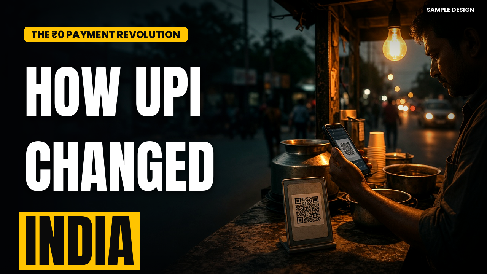
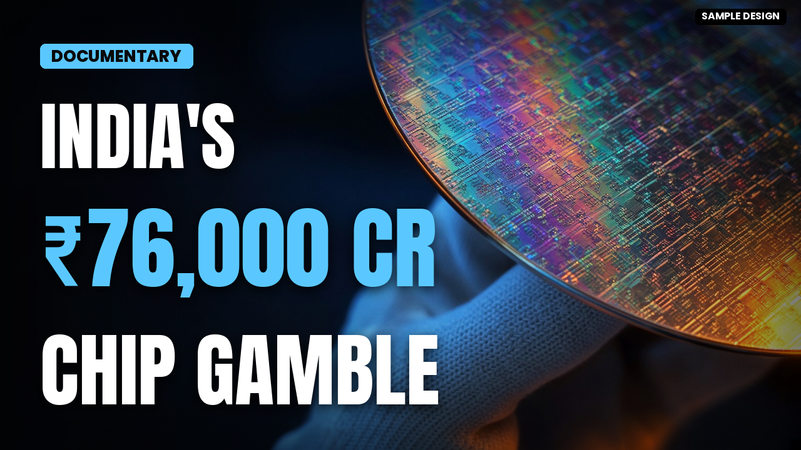
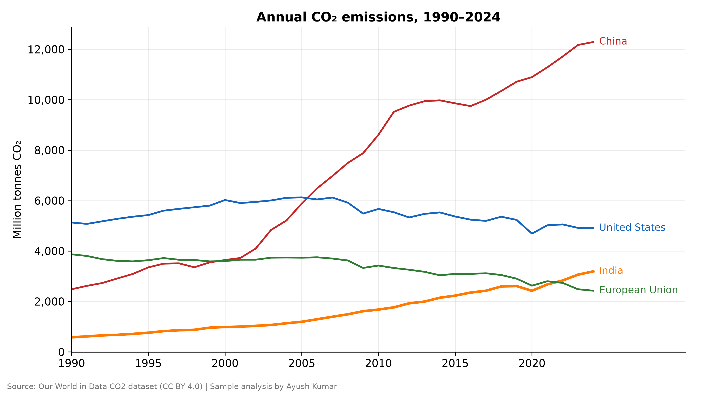
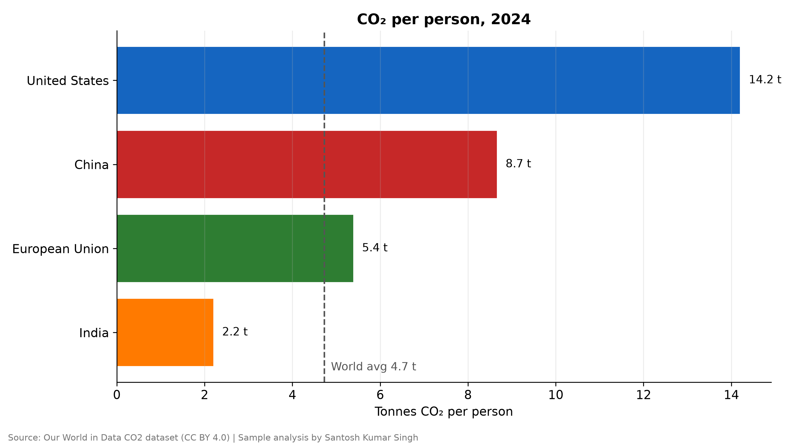
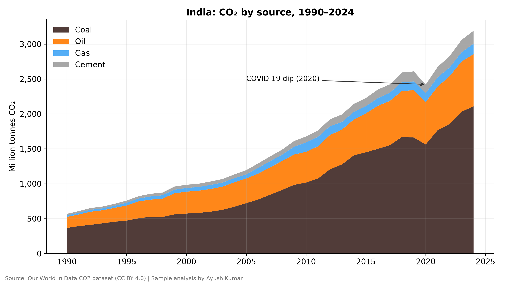

# Freelance Portfolio — Santosh Kumar Singh

I'm Santosh Kumar Singh (18, India), building with AI and Python. This repo holds **sample / demo projects** I made to show the kind of work I take on. None of it is client work and there are no client names or testimonials here — every dataset is either public or synthetic and is labelled as such.

**Portfolio:** https://santoshkumarsingh.pages.dev

**Contact:** aayush.kumaar.011@gmail.com · X [@inventor011](https://x.com/inventor011) · YouTube [@inventor0011](https://www.youtube.com/@inventor0011)

---

## 1. YouTube thumbnails (1280×720) → [`thumbnails/`](thumbnails/)
Cinematic, documentary-style thumbnails for Indian tech/finance topics. Bold 3–4 word headlines, high contrast, readable on mobile.

| | | |
|---|---|---|
|  |  |  |

## 2. Google Sheets transaction auto-categorization → [`sheets-auto-categorization/`](sheets-auto-categorization/)
Raw bank-style transactions + an editable **Rules** sheet; formulas tag every row (category, income/expense, matched keyword, review flag) with case-insensitive "contains" matching, auto-cover new rows, and roll up into a Summary. Works in Google Sheets and Excel.

## 3. Descriptive data analysis + trend charts → [`data-analysis/`](data-analysis/)
Python (pandas/matplotlib) analysis of a public dataset (Our World in Data CO₂): descriptive stats CSVs, 3 publication-ready PNG charts and a [1-page PDF summary](data-analysis/summary.pdf).

| | | |
|---|---|---|
|  |  |  |

## 4. Layout-preserving PDF → text extraction → [`pdf-layout-extractor/`](pdf-layout-extractor/)
PyMuPDF script that keeps page breaks, line wraps, indentation and table alignment, and tags **bold** / *italic* (Markdown or HTML). Includes a sample input PDF and both outputs.

---
### How I work
Fast first draft (usually within 24 hours), a clear written explanation of what I did, all source files handed over, and revisions until it matches the brief. Payments: UPI for Indian clients; bank transfer / Wise or a Stripe payment link for international clients.
